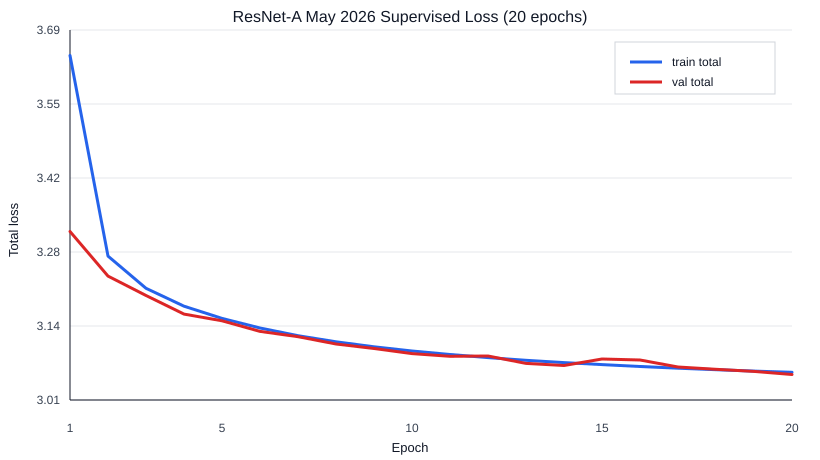
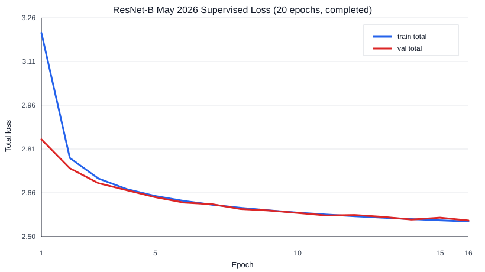

# Earlier May 2026 Supervised Training

These observations were originally recorded in the README. They are retained
here as historical training results, not a new evaluation or a claim that all
matched-architecture comparison requirements were satisfied. Run labels refer
to the saved configurations: the smaller historical ResNet-A differs from
today's built-in preset. The original summary did not provide complete runtime
and code-provenance metadata.

Source configs:
- [ResNet-A](../configs/train/lichess_2026_05_2000plus_epoch20_cached_batchmetrics.yaml)
- [ResNet-B](../configs/train/lichess_2026_05_2000plus_resnet_b_epoch20_cached_batchmetrics.yaml)

The recorded ResNet-A vs ResNet-B comparison uses the May 2026 2000+ (rating)
Lichess dataset with 73,553,382 train positions and 747,498 validation
positions. Both runs use batch size 2048, AdamW, learning rate `5e-4`, seed
`20260501`, CUDA, and the tensor cache.

| Run | Model | Params | Epochs | Validation total loss | Final validation policy loss | Status |
|---|---|---:|---:|---:|---:|---|
| ResNet-A | 32 channels, 1 block | ~0.63M | 20 of 20 | `3.3176 -> 3.0549` | `2.1960` | completed 2026-06-07 |
| ResNet-B | 64 channels, 6 blocks | ~1.06M | 20 of 20 | `2.8403 -> 2.5447` | `1.7047` | completed 2026-06-11 |

Under matched data, seed, and optimizer settings, ResNet-B's epoch-1 validation
total loss (`2.8403`) was already below ResNet-A's final epoch-20 loss
(`3.0549`). The final ResNet-B validation total loss was `2.5447`.

## Earlier Epoch-5 Value Diagnostic

The former value-head guide recorded this in-progress snapshot of
`lichess_2026_05_2000plus_epoch10_cached`, using the
[ten-epoch config](../configs/train/lichess_2026_05_2000plus_epoch10_cached.yaml).
It is retained as a weak result, without inferring missing runtime or Git metadata.

| Epoch-5 validation measurement | Recorded value |
|---|---:|
| Targets: loss / draw / win (side to move) | 344,274 / 54,287 / 348,937 |
| Constant-zero MSE | 0.9274 |
| Model value MSE | 0.8623 |
| Relative improvement over zero | About 7.0% |

The original interpretation was that some outcome signal was being learned,
but the value head remained weak pending sign accuracy, calibration, and
slice measurements. This snapshot is not the final epoch-30 result.
